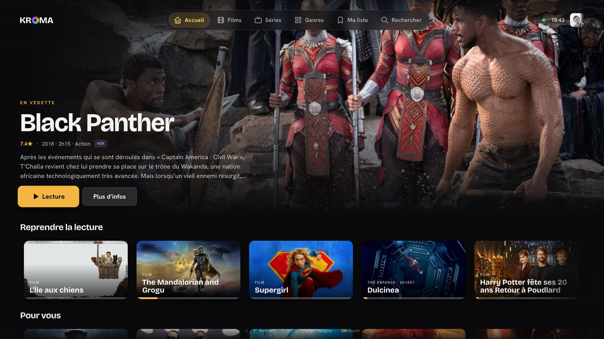
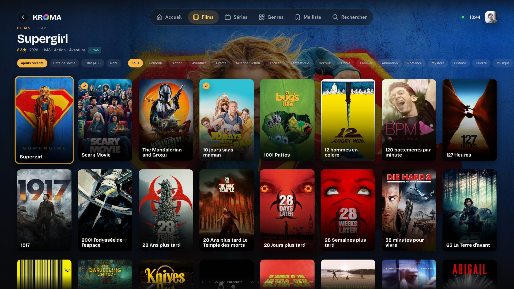

<div align="center">


<br/>
<br/>

<h3>Your own streaming service, on hardware you own.</h3>

<p>
A self-hosted media server and the apps that play from it.<br/>
One Rust binary scans your files and streams them to the web, your phone, your TV and your desktop.<br/>
Everything past playback and catalog is a module you install from inside the app.
</p>

[](https://github.com/kromatv/kroma/actions/workflows/ci.yml) [](https://sonarcloud.io/summary/new_code?id=kromatv_kroma) [](https://sonarcloud.io/component_measures?id=kromatv_kroma&metric=coverage) [](https://github.com/kromatv/kroma/releases)<br/>
[](rust-toolchain.toml) [](tsconfig.base.json) [](https://bun.sh) [](LICENSE)

<p>
<a href="https://kroma.tv">Website</a> ·
<a href="https://kroma.tv/download">Download</a> ·
<a href="docs/setup/README.md">Setup guides</a> ·
<a href="BETA.md">Join the beta</a> ·
<a href="CONTRIBUTING.md">Contributing</a>
</p>

<br/>

<table>
<tr>
<td></td>
<td></td>
</tr>
<tr>
<td align="center"><sub>The home the server builds</sub></td>
<td align="center"><sub>The library, by remote</sub></td>
</tr>
</table>

</div>

## Features

<table>
<tr>
<td width="50%" valign="top"><b>Direct play first</b><br/>The server ships the original bytes whenever the client can decode them, 10-bit and HDR included, so a NAS CPU stays idle. What a client cannot decode goes through an on-demand re-encode, on hardware where the box has it.</td>
<td width="50%" valign="top"><b>One binary</b><br/>Rust, axum and SQLite. Starts in milliseconds and idles at almost no CPU. No JVM, no compose file.</td>
</tr>
<tr>
<td valign="top"><b>Every screen</b><br/>Web, iPhone, iPad, Android, Samsung Tizen, LG webOS, Apple TV, Android TV, macOS, Windows, Linux and Steam Deck, from one codebase and one design language.</td>
<td valign="top"><b>A library from filenames</b><br/>The scanner tells movies from shows by their filenames, groups episodes into seasons, and fetches artwork and metadata with a built-in key.</td>
</tr>
<tr>
<td valign="top"><b>A home screen the server builds</b><br/>Continue watching, recently added, trending and, with the Embeddings module, rows picked for you.</td>
<td valign="top"><b>Multi-user</b><br/>Profiles, PIN locks, passkeys, invite links, per-user permissions, resume anywhere.</td>
</tr>
<tr>
<td valign="top"><b>Phone to TV</b><br/>A television on the same network shows up in the phone app and signs in with one tap. Start a title from the phone, then drive it.</td>
<td valign="top"><b>Private</b><br/>Your library and your activity never leave your network.</td>
</tr>
</table>

## Get started

KROMA is a server that holds your films and series, and apps that play them.
On a Linux computer or a NAS with Docker, one command starts the server:

```bash
docker run -d --name kroma --restart unless-stopped \
  -p 4040:4040 \
  -v kroma-data:/data \
  -v /srv/media:/media \
  ghcr.io/kromatv/kroma:latest
```

Replace `/srv/media` with the folder that holds your media. Then open
`http://SERVER_IP:4040` from a browser on the same network, create your
account, and add your folders under `/media`.

The [setup guides](docs/setup/README.md) take you through the rest, step by
step:

| To do | Guide |
| --- | --- |
| Install the server | [Docker](docs/setup/docker.md) · [Synology](docs/setup/synology.md) · [QNAP, Unraid, TrueNAS](docs/setup/other-nas.md) |
| Give it your media | [Media folders and permissions](docs/setup/media-folders.md) · [First run](docs/setup/first-run.md) |
| Install the apps | [TVs](docs/setup/tv.md) · [Samsung](docs/setup/samsung-tv.md) · [LG](docs/setup/lg-tv.md) · [Android TV and Fire TV](docs/setup/android-tv.md) · [Apple TV](docs/setup/apple-tv.md) · [Phones](docs/setup/mobile.md) · [Computers](docs/setup/desktop.md) |
| Run it | [Hardware transcoding](docs/setup/hardware-transcoding.md) · [Remote access](docs/setup/network.md) · [Updates and backups](docs/setup/updates.md) · [Configuration](docs/setup/configuration.md) · [Troubleshooting](docs/setup/troubleshooting.md) |

The same guides are on [kroma.tv/docs](https://kroma.tv/docs), in English and
French. The apps are not in the stores yet: [BETA.md](BETA.md) explains how to
join the beta.

## Modules

A fresh install is a media server, not a download stack. The rest is opt-in from
**Server** > **Modules** in the app. Each module installs in one click and releases on its own tag,
independently of the server.

| Module | What it adds |
| --- | --- |
| Indexers | a native engine running the community-maintained tracker definitions directly |
| Torznab | external Torznab and Newznab indexers |
| Torrent downloads | an embedded torrent engine, or an external download client you already run |
| Acquisition | request a title, score the releases, grab the best one, import and rename it |
| VPN | a managed WireGuard bridge with a live seal test and a kill switch |
| Embeddings | the rows picked for you, themed rows and search by meaning |
| Whisper | on-device subtitle transcription |
| Remote access | a public HTTPS share URL, optionally through a managed tunnel |
| mDNS | the server advertises itself on the LAN |

A module runs inside the server as a WebAssembly component that reaches only what
it declared, and the server checks its sha256 before unpacking it. The official catalog is
[modules.kroma.tv](https://modules.kroma.tv). Operators can add their own.

### Write one

Everything a module needs is one npm package,
[`@kromatv/sdk`](https://www.npmjs.com/package/@kromatv/sdk): the SDK and the
design system as types, the Rust crates a module links, and the `kroma` CLI.
Bun 1.4 and a Rust toolchain with the `wasm32-wasip2` target are the only
requirements.

```bash
bunx @kromatv/sdk create            # a few questions, then a project ready to run
cd tv.acme.notes
bunx kroma login http://localhost:4040   # once; an account with settings.manage
bunx kroma dev                      # build, install on your server, rebuild on every save
bunx kroma check                    # manifest, types, clippy
bunx kroma build                    # dist/modules/tv.acme.notes.kmod
```

`module.json` is the manifest, `ui/src/module.tsx` the page the KROMA app
renders with its own design system, `server/` the component the server runs.
The page's runtime is the app's, injected when the module loads, so the
package holds types only; `kroma build` refuses an import the app does not
provide. `kroma dev` uploads a debug build to whichever server you signed in
to, this machine or the NAS, and again on every save. The authoring guide is
[modules/README.md](modules/README.md); how the package is built and released
is [docs/module-sdk-publishing.md](docs/module-sdk-publishing.md).

## Develop

You need [Bun](https://bun.sh) 1.4, Rust (installed by `rustup`, which reads
the pinned version), Node.js 22.12 or later, and ffmpeg.

```bash
bun install
bun run dev          # server on :4040, web app on :3000, Samsung TV shell on :5174
```

[CONTRIBUTING.md](CONTRIBUTING.md) sets up a development machine step by step
and lists the checks a pull request must pass.
[ARCHITECTURE.md](ARCHITECTURE.md) explains how the repository is shaped: a
layered Rust server, modules as WebAssembly components, one component library
and thin shells. Each package and client has its own README.

## Contributing

Issues and pull requests are welcome. Read [CONTRIBUTING.md](CONTRIBUTING.md)
and [CODE_STYLE.md](CODE_STYLE.md) first. Security reports go through
[SECURITY.md](SECURITY.md).

## License

<div align="center">

[AGPL-3.0-or-later](LICENSE) © 2026 [Maxime Scharwath](https://github.com/maxscharwath)

</div>

Run it, change it and share it freely. Whoever distributes KROMA, or lets people
use a modified version of it over a network, has to offer them its source under
the same license.

